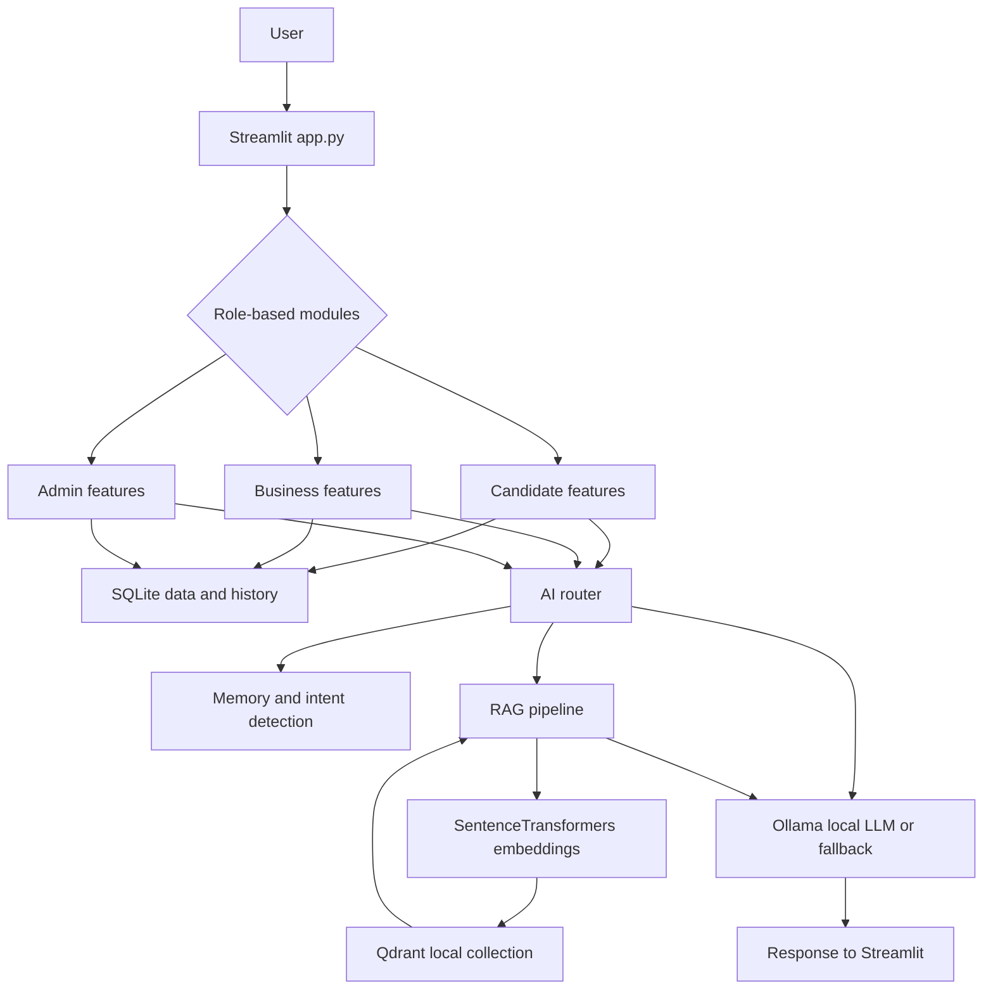

# Ardhanarishwar

An all-in-one AI assistant for candidate career development, recruitment workflows, business intelligence, and role-aware knowledge retrieval.


## Live Demo & Local Execution

[Ardhanarishwar — AI SaaS Platform · Streamlit](https://ardhanarishwar.streamlit.app/)

The live deployment is provided for quickly reviewing the application's interface and core workflow.

For the complete AI experience, local execution is recommended because the project uses **Ollama for local LLM inference** and **Qdrant for RAG/vector search**.

The local setup enables the complete functionality, including AI responses, RAG-based knowledge retrieval, document processing, and voice assistance.

This architecture was intentionally designed around local and privacy-focused AI components rather than depending entirely on paid cloud AI APIs.

Therefore, evaluators can use the live link for a quick demonstration and run the project locally for complete feature verification.


## Project Overview

Ardhanarishwar is a Python and Streamlit application with Candidate, Business, and Admin roles. It combines career tools, resume analysis, interview practice, recruitment utilities, conversational assistance, voice input/output, and a document Knowledge Base backed by local Qdrant vector search.

SQLite stores application data, SentenceTransformers creates embeddings, Qdrant stores and searches document vectors, and Ollama provides local language-model responses. Built-in fallback responses are used when Ollama is unavailable.

## Key Features

### Candidate

- Registration and login
- Candidate profile and career-goal memory
- Career Advisor and Skill Gap Analyzer
- Resume ATS Analyzer for PDF, DOCX, and TXT files
- Resume-to-job-description matching
- Interactive mock interviews with scoring
- AI Assistant with conversation history
- Voice Assistant with local speech recognition and text-to-speech
- Role-specific Knowledge Base categories

### Business

- Business registration and login
- Job Description Analyzer
- Multiple candidate resume upload
- Resume matching and candidate ranking
- Recruitment interview-question generator
- Business and HR AI Assistant
- Tenant-scoped Knowledge Base access
- Role-specific document categories

### Admin

- Platform dashboard and system metrics
- User listing and Admin-authorized user deletion
- Knowledge Base document upload and management
- Admin document deletion
- Feedback analytics
- Access to the application modules available to the Admin role

## User Roles

- **Candidate**: Career planning, skill-gap analysis, resume, interview, chat, voice, and profile tools.
- **Business**: Recruitment, candidate matching, business intelligence, chat, and company knowledge tools.
- **Admin**: Platform metrics, user management, global knowledge documents, analytics, and the broader application module set.

The sidebar navigation is role-specific. Admin includes Resume Analyzer, Career Advisor, Recruitment Engine, Business Intelligence, Knowledge Base, Analytics, and User Management.

## Technology Stack

- Python 3.10+
- Streamlit
- SQLite
- Ollama through its HTTP API
- `requests`
- Qdrant Client with local file storage
- SentenceTransformers with `all-MiniLM-L6-v2`
- PyMuPDF (`fitz`)
- `python-docx`
- Pandas and Plotly
- SpeechRecognition with local PocketSphinx recognition
- `pyttsx3` for text-to-speech

No FastAPI, Flask, React, Node.js, PostgreSQL, MongoDB, or paid third-party AI API is used by the current implementation.

## Architecture



## Project Structure

```text
app.py                    Streamlit entry point, authentication, navigation, dashboards
config.py                 Paths, model settings, roles, and document categories
requirements.txt          Python package requirements
core/
  embeddings.py           Lazy SentenceTransformer embedding wrapper
  llm.py                  Ollama HTTP client and fallback responses
  memory.py               Profile and conversation memory orchestration
  qdrant.py               Local Qdrant storage, search, upsert, and deletion
  rag.py                  Document ingestion, retrieval, and deletion workflow
  router.py               Intent detection and AI request orchestration
database/
  database.py             SQLite connection, schema creation, and seed users
  models.py               Authentication, profiles, history, documents, metrics, permissions
modules/
  career.py               Career Advisor and Skill Gap UI
  resume.py               Resume ATS Analyzer and JD Matcher
  interview.py            Interactive mock interview UI
  recruitment.py          JD analysis, batch matching, and interview questions
  business.py             Business and HR assistant UI
  voice.py                Voice input and text-to-speech UI
utils/
  helpers.py              Shared CSS and header rendering
  pdf.py                  PDF, DOCX, and TXT extraction plus resume parsing
  scoring.py              ATS, JD matching, and skill-gap calculations
assets/
  styles.css              Additional stylesheet file
data/
  ardhanarishwar.db       Runtime SQLite database
  qdrant_storage/         Runtime local Qdrant storage
```

## Authentication

Registration and login are implemented in `app.py` and `database/models.py`.

- New accounts are stored in SQLite.
- Passwords are hashed before storage by the database helper.
- Each user has a role and tenant id.
- The authenticated user is stored in Streamlit session state.
- Logout clears the active user session.
- Default demo users are seeded automatically when the users table is empty.

The configured demo credentials are intentionally not exposed in this README. They can be found in the local database initialization code for a controlled demonstration.

## Candidate Workflow

```text
Register/Login
  -> Candidate Profile
  -> Career Advisor and Skill Gap
  -> Resume ATS Analysis
  -> Resume-JD Matching
  -> Mock Interview
  -> AI Assistant
  -> Voice Assistant
  -> Logout
```

Candidate profiles, resume analyses, interviews, conversations, and messages are stored through the SQLite model layer.

## Business Workflow

```text
Login
  -> Job Description Analyzer
  -> Upload Multiple Resumes
  -> Resume-JD Matching
  -> Candidate Ranking
  -> Business AI Assistant and RAG Knowledge Base
  -> Logout
```

Batch ranking is calculated in memory for the current interaction. Business AI requests pass the current tenant id to RAG retrieval.

## Admin Workflow

```text
Login
  -> Admin Dashboard
  -> Platform Metrics
  -> User Management
  -> Knowledge Base
  -> Feedback Analytics
  -> Logout
```

Admin dashboard metrics are platform-wide. Admin can delete managed users except the active Admin account and can manage documents through the Admin permission path.

## AI Architecture

```text
User Query
  -> Intent Detection
  -> Candidate Profile Memory
  -> Tenant-aware RAG Retrieval
  -> Prompt Construction
  -> Ollama Generation or Fallback Response
  -> Streamlit Response
```

`core/router.py` coordinates intent detection, profile context, RAG retrieval, prompt construction, LLM generation, and optional conversation persistence.

## RAG Pipeline

```text
Document Upload
  -> PDF/DOCX/TXT Text Extraction
  -> Paragraph-based Character Chunking
  -> SentenceTransformer Embeddings
  -> Qdrant Upsert
  -> Cosine Similarity Search
  -> Relevant Context
  -> Ollama Prompt
  -> Response
```

The Qdrant collection is `ardhanarishwar_kb` and uses 384-dimensional cosine-distance vectors. SQLite stores document id, name, category, source, tenant id, uploader id, chunk count, and timestamp. Role-specific categories are selected in the UI and validated during ingestion. Deletion checks role, tenant, and uploader permissions before removing Qdrant points and metadata.

## Database

`database/database.py` creates the SQLite database and these tables automatically:

- `users`: usernames, password hashes, roles, tenant ids, and profile details
- `candidate_profiles`: education, skills, experience, goals, and learning interests
- `conversations`: user conversation sessions and tenant information
- `messages`: user and assistant messages with optional source data
- `documents`: Knowledge Base document metadata
- `mock_interviews`: completed interview scores and feedback
- `resume_analyses`: ATS and JD matching results
- `feedback`: user ratings and comments

The database path is `data/ardhanarishwar.db`. The data directory is created automatically by configuration code. No manual database or table creation is required.

## Voice Assistant

The Voice Assistant supports:

- SpeechRecognition for microphone capture
- Local PocketSphinx speech-to-text through `recognize_sphinx()`
- Ollama or fallback processing through the shared AI router
- Local `pyttsx3` text-to-speech output

Microphone input requires a working Windows audio device and microphone permissions. Recognition quality depends on the local audio environment. Typed input remains available when microphone transcription is unavailable.

## Installation

### Prerequisites

- Python 3.10 or newer
- Optional: Ollama for live local LLM responses
- Optional: microphone and Windows microphone permission for voice input

From the project root on Windows:

```powershell
python -m venv .venv
.\.venv\Scripts\Activate.ps1
python -m pip install -r requirements.txt
```

The first embedding operation may download `all-MiniLM-L6-v2`, so internet access may be required once unless the model is already cached.

### Ollama Setup

Ollama is optional because the application provides fallback responses. For live model responses:

```text
ollama serve
ollama pull llama3.2
```

Qdrant is embedded through `qdrant-client`; no separate server, collection command, or API key is required.

## Running the Project

```text
streamlit run app.py
```

The Streamlit interface is normally available at `http://localhost:8501`.

## Configuration

Configuration is centralized in `config.py`:

- Database: `data/ardhanarishwar.db`
- Qdrant storage: `data/qdrant_storage`
- Qdrant collection: `ardhanarishwar_kb`
- Ollama URL: defaults to `http://localhost:11434`; override with `OLLAMA_BASE_URL`
- Ollama model: defaults to `llama3.2`; override with `OLLAMA_MODEL`
- Embedding model: `all-MiniLM-L6-v2`
- Role-specific document category lists

No `.env` file or API key is required by the current code.

## Default/Demo Accounts

The application seeds default demo users during database initialization when the users table is empty. Check the local database initialization code for the configured demo credentials. Do not use demo accounts for production deployment.

## Security and Limitations

Verified limitations of the current implementation include:

- Password hashing uses a hardcoded salt and SHA-256 rather than a dedicated password KDF.
- Demo account credentials exist in local initialization code.
- Session authentication has no timeout, MFA, rate limiting, or password reset workflow.
- The Knowledge Base page obtains the complete document list before applying deletion controls.
- A shared Qdrant collection is used, with tenant filtering applied to the main chat, Business Assistant, and Voice Assistant request paths.
- Qdrant and SQLite operations are separate and are not transactional.
- Upload size and processing limits are not enforced.
- Image-only PDFs are not OCR processed, and DOCX tables are not extracted.
- Streamlit reruns can repeat some resume-analysis or interview-history writes.
- Retrieved document text is supplied to the LLM prompt and should be treated as untrusted content.

## Scalability

The current project is a local-first MVP designed to run as a single Streamlit process. SQLite and local Qdrant file storage are suitable for development and demonstrations, while the role, tenant, RAG, and model boundaries provide a foundation for a larger product.

For production scale, the application would need a persistent multi-user database, durable shared vector storage, background processing for document ingestion, centralized authentication/session management, monitoring, and a separately managed inference service. These production components are not included in the current repository.

## Deployment Limitations

- The application can be deployed as a Streamlit service, but local SQLite and Qdrant files may not persist across ephemeral host restarts.
- Ollama must be reachable from the deployed environment for live model responses; a local `localhost` Ollama service on the developer machine is not reachable from a remote deployment.
- The embedding model may need to download on first use, requiring network access unless it is already cached.
- Server-side microphone capture is not equivalent to browser microphone access, so the Voice Assistant is environment-dependent when deployed remotely.
- No external persistent database, managed Qdrant service, job queue, or production authentication provider is configured by this project.

## Business Use Cases

- Candidate career planning, skill-gap analysis, learning guidance, and interview preparation
- Resume ATS review and comparison against a target job description
- Business job-description analysis and batch candidate resume ranking
- HR screening guidance and recruitment interview-question generation
- Tenant-aware business knowledge retrieval from uploaded company documents
- Admin monitoring of users, activity metrics, feedback, and shared Knowledge Base content

## Market Differentiation

The project differentiates itself as a single role-aware workspace that combines candidate growth and business recruitment workflows instead of treating them as separate tools. Its main technical differentiators are local Ollama inference, SentenceTransformers embeddings, Qdrant-based RAG, SQLite-backed memory, and an extensible role/tenant model without requiring paid proprietary LLM APIs.

This is the current product direction rather than a claim of production-scale capability. The present implementation is an MVP and still requires stronger persistence, security, observability, and deployment infrastructure for enterprise use.

## Future Improvements

Future work may include stronger password hashing, session expiry, stricter document-list filtering, transactional vector/metadata operations, upload limits, OCR, database migrations, persistent recruitment results, and automated tests. These are future improvements, not current features.

## Interview-Level Project Summary

Ardhanarishwar is a role-based AI SaaS MVP built with Python and Streamlit. It combines candidate career planning, resume intelligence, mock interviews, business recruitment workflows, and a RAG Knowledge Base. SentenceTransformers and Qdrant provide semantic document retrieval, while Ollama provides local language-model inference. SQLite stores authentication, profiles, conversations, documents, analysis history, and feedback. The project demonstrates an AI assistant platform without depending on paid proprietary LLM APIs.

## Deployment Note

The application uses Ollama for local AI responses at `http://localhost:11434`.

For cloud deployment platforms such as Render, Ollama may not be available in the same environment. In that case, the application remains functional and uses its built-in fallback responses, but live local-LLM responses require Ollama to be running on the host machine.
